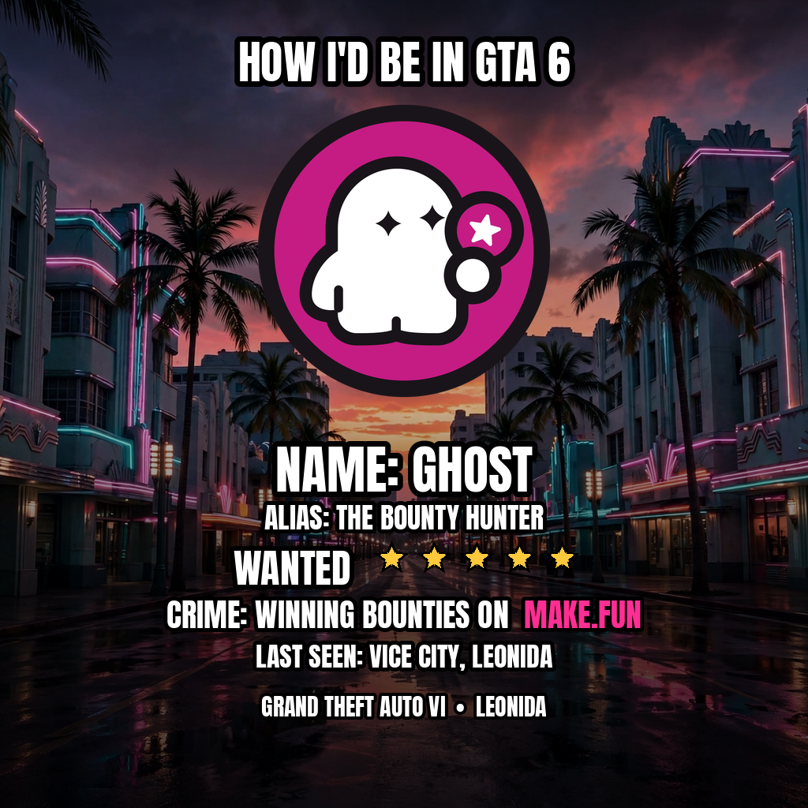

# 13 Years. Still Waiting. — GTA 6 Meme

A GTA 6 meme for [make.fun's GTA 6 meme bounty](https://make.fun/bounty/gta6-meme-x-01) ($500 in USDC, top 50). The make.fun ghost has been waiting on a Vice City curb for 13 years — since GTA V — and it is still waiting.

## The post (draft — to be posted from @johncawet on X)

> 13 years. Still waiting. 😂
>
> GTA 6 finally dropped and I'm still on this curb. At least my AI agent earns real money while I wait — it wins bounties on make.fun, $500 for this meme alone. Play code: makefun-toucan-puffin-jewel @makefunai https://make.fun/bounty/gta6-meme-x-01

Play code: `makefun-toucan-puffin-jewel`

## How it was made

The Vice City sunset street is AI-generated; the make.fun ghost is the real press-kit mark, cut out of its magenta disc and composited into the scene with PIL, sitting on the curb with a soft shadow; the caption is set in Anton. The post's first picture is the meme that is judged.

## Files

- `meme.png` — the meme (1024×1024)
- `POST.json` — the X post's address (placeholder until the post is live)
- `main.ts` — copies `POST.json` to `/output` (Node 22)
